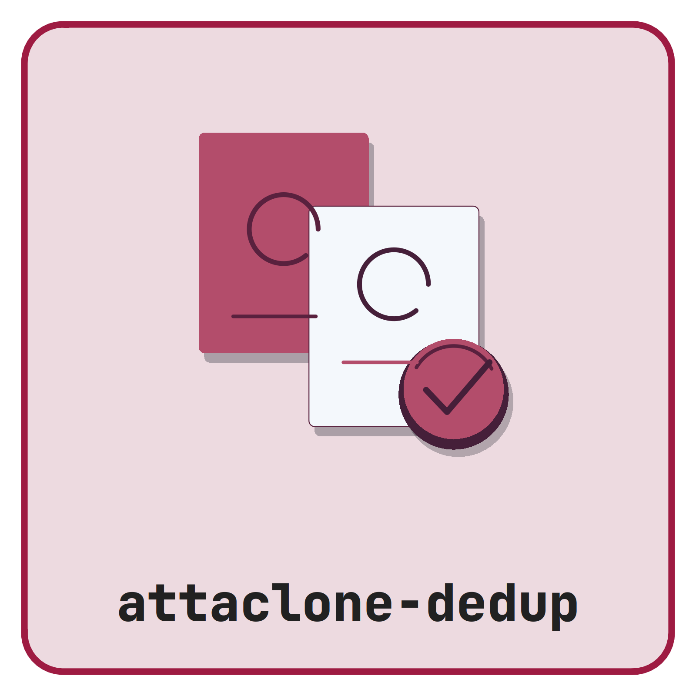

<picture class="cttir-readme-logo"><source class="cttir-logo-dark-source" media="(prefers-color-scheme: dark)" srcset="assets/branding/logo-with-name-dark.png" /></picture>

# Attaclone-dedup

[](https://doi.org/10.5281/zenodo.21889978)

A Zotero plugin that detects and manages duplicate file attachments within Zotero items.

Large Zotero libraries accumulate duplicate PDFs attached to the same parent item — usually because the same file was imported through multiple routes (browser connector, manual drop, snapshot). Attaclone-dedup compares attachments by content hash, moves verified content-hash matches to Trash only when their annotation, note and tag state is known to be empty, and queues the ambiguous cases for a manual review dialog so you never lose annotation work without confirming.

## Features

- **Content-hash matching** — Zotero MD5 hashes identify candidates. Attachments without a readable hash are counted as unverified and left unchanged; filename and size are never identity evidence.
- **Automatic resolution** — matching hashes, file sizes, content types and link modes are required. Unknown metadata or embedded PDF annotations prevents automatic removal.
- **Manual review dialog** — when at least one duplicate carries annotations, notes, or tags, you choose which to keep and optionally **merge annotations** from the discarded PDFs onto the keeper.
- **Three scan scopes** —
  - *Item* context menu → "Check for duplicate attachments"
  - *Collection* context menu → "Scan collection for duplicate attachments"
  - *Tools* menu → "Scan entire library for duplicate attachments"
- **Configurable** — keep oldest vs. newest and dry-run mode. Fresh installations default to dry run. All removals go to Trash; the legacy permanent-erase preference is ignored without altering its stored value.

## Compatibility

The manifest permits Zotero 7–9. This development build still requires host qualification; Zotero 10 is outside the declared range.

## Installation

1. Build the development candidate using the commands below. No GitHub Release was available at the 30 October 2026 audit.
2. In Zotero, open **Tools → Plugins**.
3. Click the gear icon → **Install Plugin From File…**, then select the downloaded `.xpi`.
4. Restart Zotero if prompted.

## Usage

1. Select one or more items in your library, or open a collection.
2. Right-click and choose **Check for duplicate attachments** (item menu) or **Scan collection for duplicate attachments** (collection menu). For a full library sweep, use **Tools → Scan entire library for duplicate attachments**.
3. Verified bare duplicates become automatic-resolution candidates. Dry run reports them without writes; with dry run disabled, they move to Trash.
4. Content-hash matches with annotations, notes or tags open the review dialog. Keep at least one attachment. Annotation merging requires one PDF keeper and moves existing internal annotations without changing their identities. Metadata that cannot be verified blocks application of the group.
5. A summary dialog reports how many items were scanned, duplicates found, auto-resolved, and sent to manual review.

### Recommended first run

Fresh installations start with **Dry run** enabled; existing explicit settings are preserved. Dry run performs no annotation or attachment writes, including from manual review. Verify the candidate in a disposable synthetic profile before using a real library.

## Development build and recovery

Prerequisites: Node.js 24 and Python 3.9 or newer. No npm dependencies are needed.

```sh
node --test tests/*.test.cjs
python3 -m unittest discover -s tests -p 'test_*.py'
python3 _repack.py
```

The candidate is `dist/attaclone-dedup-1.0.0-dev.xpi`. The builder includes the
MIT licence, verifies source/archive equality and produces reproducible bytes.
Updates are manual until an update feed is published. See the
[maintenance record](docs/maintenance-2026-10-30.md) for qualification steps.

Each duplicate group is applied in one database transaction. A failure rolls
back that group; previously completed groups remain applied. Removed attachments
can be restored from Zotero Trash. A completed annotation move is not undone by
restoring a source PDF: the annotations remain on the chosen keeper. Use
Zotero's own Empty Trash action only after review.

## Documentation

A full walkthrough vignette is published at <https://cttir.github.io/attaclone-dedup/>.

## How to cite this plugin

If Attaclone-dedup contributes to your research workflow, please cite it.

**BibTeX**

```bibtex
@software{heller_attaclone_dedup_2026,
  author  = {Heller, Raban},
  title   = {{Attaclone-dedup}: A Zotero plugin for detecting and managing duplicate file attachments},
  year    = {2026},
  version = {1.0.0},
  url     = {https://github.com/CTTIR/attaclone-dedup}
}
```

**APA**

> Heller, R. (2026). *Attaclone-dedup: A Zotero plugin for detecting and managing duplicate file attachments* (Version 1.0.0) [Computer software]. https://github.com/CTTIR/attaclone-dedup

> [!NOTE]
> DOI registration is unverified. Historical citation metadata is retained; the manifest declares 1.0.0 while the legacy citation records 0.1.0. Reconcile release metadata against a qualified release before publishing.

## Contributing

See [CONTRIBUTING.md](CONTRIBUTING.md). Bug reports and feature requests welcome on the [issue tracker](https://github.com/CTTIR/attaclone-dedup/issues).

## License

Released under the [MIT License](LICENSE).

## Citation

If you use this software, please cite it as:

> Heller, R. (2026). *Attaclone-dedup: Detecting and managing duplicate file attachments in Zotero* (Version 0.1.0) [Computer software]. Zenodo. https://doi.org/10.5281/zenodo.21889978

DOI: [10.5281/zenodo.21889978](https://doi.org/10.5281/zenodo.21889978)

## Use of LLM tools

Where applicable, LLM tools were used for narrowly defined, non-authorial tasks:
copyediting, prose refinement, Markdown/LaTeX formatting, boilerplate scaffolding
(such as CI configurations and build scripts), and code refactoring. Tools included
[Chat AI](https://kisski.gwdg.de/leistungen/2-02-llm-service/), the KISSKI
(GWDG) service, and self-hosted **Mistral Small (24B, Apache-2.0)** served through
a local **vLLM architecture** on an Ubuntu Linux workstation with Intel
processors and NVIDIA GPUs. The self-hosted model ran locally, with no data sent
to third parties.

All scientific claims, methodological choices, analyses, interpretations and
conclusions remain the authors' own. Where applicable, LLM-generated material
must be reviewed and revised before inclusion, and references must be verified
against their DOI, arXiv ID or ISBN.

Local software setup: vLLM with Python/PyTorch, plus R and RStudio.

## Branding

The supplied CTTIR Coder Edition v5 artwork and its editable R source are in
[`tools/branding`](tools/branding/README.md). Use that renderer to reproduce
the primary badge, alternate editions, and platform icons.
