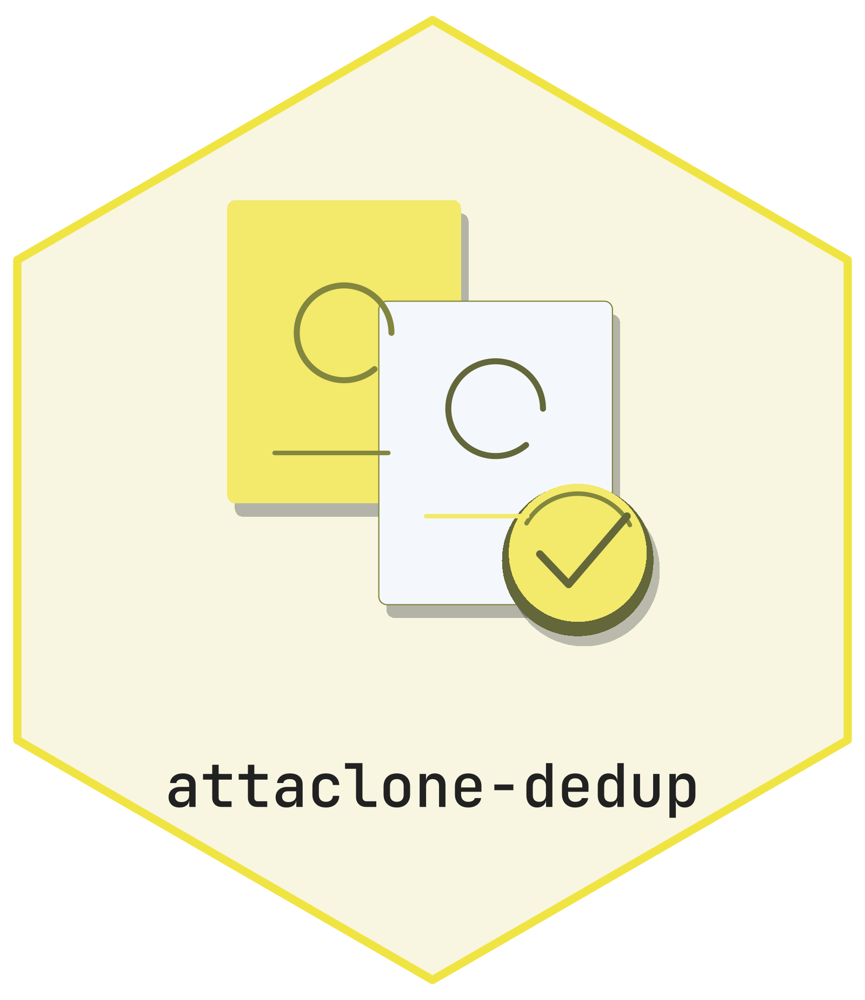

<picture class="cttir-readme-logo"><source class="cttir-logo-dark-source" media="(prefers-color-scheme: dark)" srcset="assets/branding/logo-with-name-dark.png" /></picture>

# Attaclone-dedup

[](https://doi.org/10.5281/zenodo.21889978)

A Zotero plugin for reviewing byte-identical PDF attachments within one parent
item. Version **1.0.1 is an unpublished safety revision for Zotero 10.0.x**.
New installations preview changes by default. Actual changes move attachments to
Zotero Trash; permanent erase is no longer supported.

## What it checks

- SHA-256 of existing, nonempty files; names and file sizes alone never establish
  a duplicate. Missing files and failed metadata/hash reads are reported and kept.
- Annotations (including trashed annotations), notes, tags, current permissions,
  pending edits, and parent/library identity before changing anything.
- Current file content and metadata again when applying a reviewed selection.
- Native annotation transfer and trash operations in one Zotero transaction.
  A failed transfer/save rolls back; annotation keys are preserved.
- PDFs with incoming/outgoing relations, note references, or external annotations
  are kept. Other file types, including multi-file HTML snapshots, are excluded.

Automatic resolution is restricted to verified identical copies with no
annotations, notes, or tags. Other verified groups open a manual dialog that
initially keeps every copy. A transfer requires exactly one keeper. Notes and
tags are not merged; retain any attachment whose metadata you need.
If rollback cannot reload cached items, further changes are blocked until Zotero
restarts. Note references are checked across the library, including trashed notes.

## Build and install the candidate

No dependency installation is needed to build. Use Python 3.10+ and Node.js 18+
for package and regression checks:

```bash
node --test tests/*.test.js
python3 tools/build_xpi.py
python3 tools/check_xpi.py dist/attaclone-dedup-1.0.1.xpi
```

The builder uses an explicit runtime-file list, fixed ZIP metadata, and refuses
to overwrite a different existing archive. `python3 _repack.py` remains a
compatible entry point. Previous archives are preserved.

Install the resulting XPI through **Tools → Plugins → Install Plugin From File**
in a disposable Zotero profile first. Review [the audit and validation record](docs/audit/2026-10-30.md)
before using it on your main library. The revised source and tests do not by
themselves establish that every live UI path works; live qualification is tracked
separately. The declared maximum is the tested minor line, `10.0.*`.

## First use

1. Keep a full backup of your Zotero data directory, including attachment storage.
2. Confirm **Dry run** is enabled in Zotero's Attaclone-dedup settings. Existing
   saved preferences are retained, so an earlier disabled value stays disabled.
3. Scan a small selection with **Check for duplicate attachments**. Review the
   warnings and the preview count; dry run does not even transfer annotations.
4. For manual groups, all copies are kept initially. Choose removals explicitly.
5. Disable dry run only when ready to move verified copies to Trash. Restore
   mistaken removals from Trash; do not empty Trash before checking the results.

Collection and whole-library scans are also available. Another scan cannot start
while one is running. Read-only libraries and items with unsaved changes are kept.
Each scan retains its initial preview mode. Enabling dry run or disabling the
plugin cancels further writes; a later apply requires another scan.

## Using this with Zotero Library Workbench

Run Workbench backup/extraction/audit with Zotero closed. Close Workbench operations
before running live plugin changes. After deduplication, run Workbench extraction
and audit again: the previous manifest describes the old attachment set. Workbench
snapshots cover the database only; full recovery needs the attachment files too.

## Documentation

See [the walkthrough](docs/vignette.qmd) and [the local safety audit](docs/audit/2026-10-30.md).
The hosted site and archived citation below may describe an earlier published
version; this working revision has not been released or assigned a new DOI.

## Contributing

See [CONTRIBUTING.md](CONTRIBUTING.md). Bug reports and feature requests welcome on the [issue tracker](https://github.com/CTTIR/attaclone-dedup/issues).

## License

Released under the [MIT License](LICENSE).

## Archived citation

The existing archive record is retained below. It does not claim publication of this working revision:

> Heller, R. (2026). *Attaclone-dedup: Detecting and managing duplicate file attachments in Zotero* (Version 0.1.0) [Computer software]. Zenodo. https://doi.org/10.5281/zenodo.21889978

DOI: [10.5281/zenodo.21889978](https://doi.org/10.5281/zenodo.21889978)

## Use of LLM tools

Where applicable, LLM tools were used for narrowly defined, non-authorial tasks:
copyediting, prose refinement, Markdown/LaTeX formatting, boilerplate scaffolding
(such as CI configurations and build scripts), and code refactoring. Tools included
[Chat AI](https://kisski.gwdg.de/leistungen/2-02-llm-service/), the KISSKI
(GWDG) service, and self-hosted **Mistral Small (24B, Apache-2.0)** served through
a local **vLLM architecture** on an Ubuntu Linux workstation with Intel
processors and NVIDIA GPUs. The self-hosted model ran locally, with no data sent
to third parties.

All scientific claims, methodological choices, analyses, interpretations and
conclusions remain the authors' own. Where applicable, LLM-generated material
must be reviewed and revised before inclusion, and references must be verified
against their DOI, arXiv ID or ISBN.

Local software setup: vLLM with Python/PyTorch, plus R and RStudio.

## Branding

The supplied CTTIR Coder Edition v5 artwork and its editable R source are in
[`tools/branding`](tools/branding/README.md). Use that renderer to reproduce
the primary badge, alternate editions, and platform icons.
