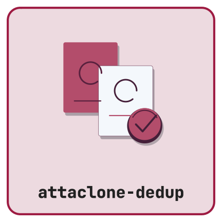

{height=139px fig-alt="attaclone-dedup hex logo"}

## What it does

Large Zotero libraries accumulate duplicate PDFs attached to the same parent item — usually because the same file was imported through multiple routes (browser connector, manual drop, snapshot). **Attaclone-dedup** compares attachments by content hash, moves verified bare duplicates to Trash, and queues the ambiguous cases (anything carrying annotations, notes, or tags) for a manual review dialog so you never lose annotation work without confirming.

## Highlights

- Zotero content-hash matching (MD5). Missing hashes are reported and left unchanged.
- Automatic resolution requires verified file and metadata state. Embedded annotations and unreadable metadata require review or block changes.
- Manual review dialog with optional **annotation merging** from discarded PDFs to the kept PDF.
- Scan scopes: selected items, current collection, or entire library.
- Dry-run mode defaults on for fresh installations and prevents every write. All removals use Trash.

## Get started

- [Installation](vignette.qmd#installation)
- [Walkthrough](vignette.qmd)
- [Source code on GitHub](https://github.com/CTTIR/attaclone-dedup)
- [Issue tracker](https://github.com/CTTIR/attaclone-dedup/issues)

## Compatibility

The manifest permits Zotero 7–9. Host qualification is pending; Zotero 10 is outside the declared range.

## Citation

If you use Attaclone-dedup in published work, please cite it. The
canonical metadata lives in
[`CITATION.cff`](https://github.com/CTTIR/attaclone-dedup/blob/main/CITATION.cff).

**BibTeX**

```bibtex
@software{heller_attaclone_dedup_2026,
  author  = {Heller, Raban},
  title   = {Attaclone-dedup: a Zotero plugin for detecting and managing
             duplicate file attachments},
  year    = {2026},
  version = {1.0.0},
  license = {MIT},
  url     = {https://github.com/CTTIR/attaclone-dedup},
  note    = {Development build; host qualification pending}
}
```

**APA**

> Heller, R. (2026). *Attaclone-dedup: a Zotero plugin for detecting and
> managing duplicate file attachments* (Version 1.0.0) [Computer
> software]. https://github.com/CTTIR/attaclone-dedup
