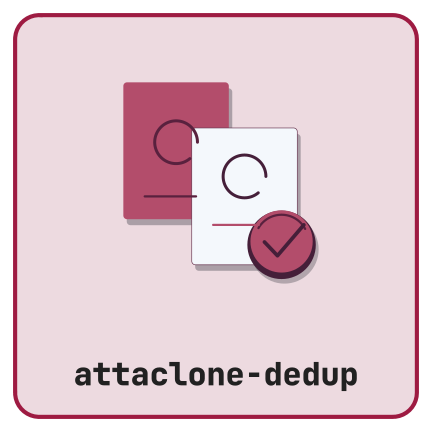

{height=160px}


This vignette walks through a realistic end-to-end use of Attaclone-dedup: install the plugin, configure preferences, run a scan on a small selection, handle an ambiguous case via the manual dialog, then run a full-library sweep.

## Installation {#installation}

1. Run `python3 _repack.py` from the repository root and use `dist/attaclone-dedup-1.0.0-dev.xpi` in a disposable profile. No GitHub Release was available at the 30 October 2026 audit; host qualification is pending.
2. In Zotero, open **Tools → Plugins**.
3. Click the gear icon and choose **Install Plugin From File…**.
4. Select the downloaded `.xpi`. Restart Zotero if prompted.


## Preferences

Open **Edit → Settings → Attaclone-dedup**.

| Preference        | Default   | Effect                                                                   |
|-------------------|-----------|--------------------------------------------------------------------------|
| Dry run           | on (new installs) | If on, scans report what *would* be removed but do not change anything.  |
| Keep strategy     | `oldest`  | When auto-resolving, which copy to keep (by `dateAdded`).                |
| Removal behavior  | Trash only | All removals are reversible through Trash. Legacy erase settings are ignored. |

::: {.callout-tip}
For your first full-library run, enable **Dry run**. Review the summary, then turn it off.
:::


## Scan a selection

1. Select one or more items in your library.
2. Right-click → **Check for duplicate attachments**.


Verified matching hashes with empty, readable annotation/note/tag state are automatic-resolution candidates. Dry run does not change them. Missing hashes are counted as unverified and left unchanged; other unresolved metadata prevents applying changes.

## Handle an ambiguous case

If a duplicate group has any member with annotations, notes, or tags, you'll see the manual-resolve dialog:

- Tick the attachments you want to **keep**.
- Optionally tick **Merge annotations onto the kept PDF** — internal annotations are moved to exactly one PDF keeper before the source attachment goes to Trash. Their identities are preserved; failures roll back the group. Embedded annotations must remain in their original PDF.
- Confirm.


## Scan a collection or the whole library

- A single collection: right-click the collection → **Scan collection for duplicate attachments**.
- Everything in the library: **Tools → Scan entire library for duplicate attachments**. You'll be asked to confirm.

A progress window runs during the sweep. A summary dialog reports items scanned, duplicates found, auto-resolved, and how many were sent to manual review.


## Recovery

All removed attachments remain in Zotero Trash. The plugin no longer performs permanent erasure because filesystem deletion cannot be rolled back with the database. Restore attachments from Trash if needed; a completed annotation move leaves annotations on the keeper. Each group is transactional, while earlier completed groups remain applied if a later group fails.

## Reporting issues

Please include your Zotero version, OS, plugin version, and any `Attaclone-dedup:`-prefixed lines from **Help → Debug Output Logging** when filing a bug. See the [issue tracker](https://github.com/CTTIR/attaclone-dedup/issues).

## Development verification

```sh
node --test tests/*.test.cjs
python3 -m unittest discover -s tests -p 'test_*.py'
python3 _repack.py
```

These commands need Node.js 24 and Python 3.9+. They exercise synthetic host
contracts and package contents. They do not establish real Zotero database,
filesystem, synchronization or user-interface behavior. Complete the host
qualification in the source repository's maintenance record before release.
